# mjsim

Build robotics and deformable-object simulations with MuJoCo. mjsim brings
controllers, motion planners, sensors, and reusable scene builders together in Python.

- **Control robots:** operational-space impedance control and Cartesian movement primitives.
- **Plan motion:** joint-space and task-space planning with OMPL.
- **Work with soft materials:** cables, cloth, elastic solids, and mesh-based deformables.
- **See and feel:** RGB, depth, segmentation, point clouds, and GelSight tactile sensing.

[Quick start](docs/quickstart/README.md) · [Examples](examples/GUIDE.md) · [Documentation](docs/README.md)

## Examples

<table>
  <tr>
    <td><a href="examples/physics/models/extended/sleep/dominos.xml">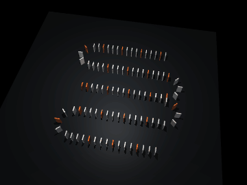</a></td>
    <td><a href="examples/physics/models/replicate/newton_cradle.xml">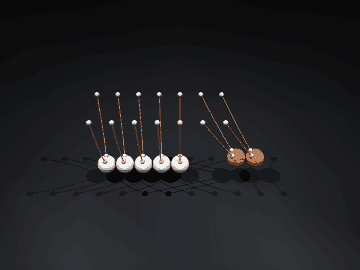</a></td>
    <td><a href="examples/physics/models/extended/car/car.xml">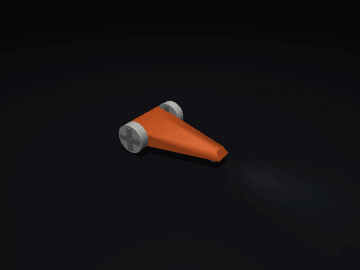</a></td>
  </tr>
  <tr>
    <td><a href="examples/physics/models/extended/plugin/sdf/gear.xml">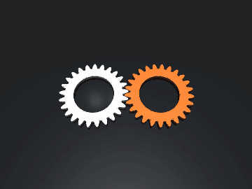</a></td>
    <td><a href="examples/physics/models/extended/plugin/sdf/nutbolt.xml">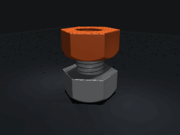</a></td>
    <td><a href="examples/physics/models/extended/cube/cube_3x3x3.xml">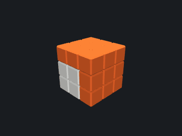</a></td>
  </tr>
  <tr>
    <td><a href="examples/physics/models/extended/flex/flag.xml">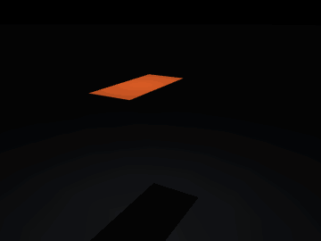</a></td>
    <td><a href="examples/physics/models/extended/flex/trampoline.xml">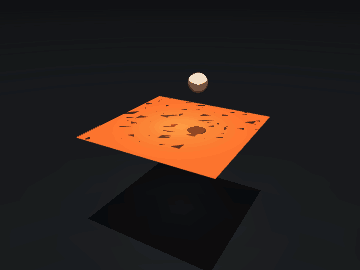</a></td>
    <td><a href="examples/physics/models/hammock/hammock.xml">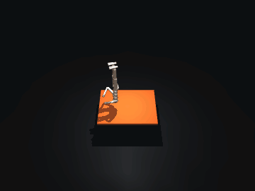</a></td>
  </tr>
  <tr>
    <td><a href="examples/physics/models/extended/flex/basket.xml">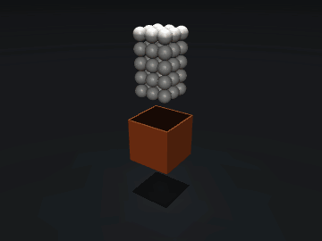</a></td>
    <td><a href="examples/physics/models/flex/jelly.xml">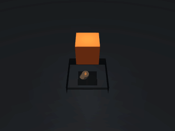</a></td>
    <td><a href="examples/physics/models/extended/flex/gripper_trilinear.xml">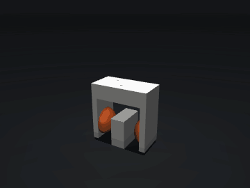</a></td>
  </tr>
  <tr>
    <td><a href="examples/physics/models/extended/flex/pulley.xml">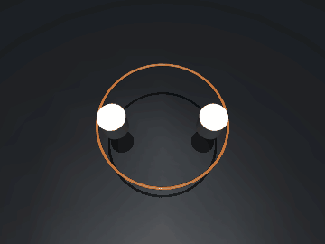</a></td>
    <td><a href="examples/physics/models/extended/flex/coil.xml">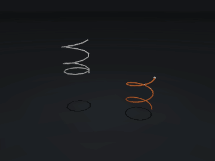</a></td>
    <td><a href="examples/physics/models/tendon_arm/arm26.xml">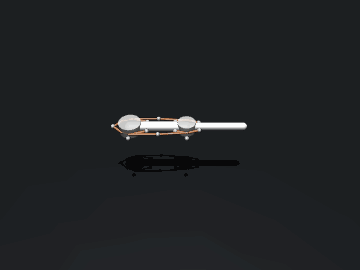</a></td>
  </tr>
  <tr>
    <td><a href="examples/physics/models/balloons/balloons.xml">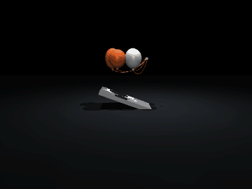</a></td>
    <td><a href="examples/physics/models/adhesion/active_adhesion.xml">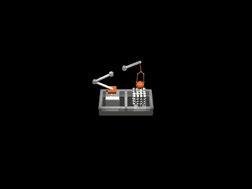</a></td>
    <td><a href="examples/physics/models/extended/surfacevel/treadmill.xml">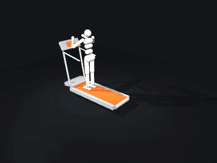</a></td>
  </tr>
  <tr>
    <td><a href="examples/conveyor_belt.py">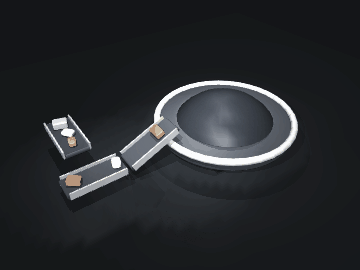</a></td>
    <td><a href="examples/particle_container.py">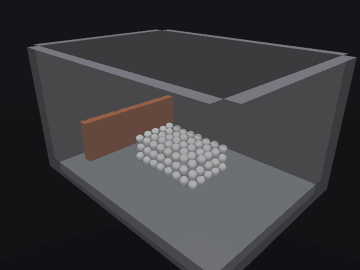</a></td>
    <td><a href="examples/mj_xml.py">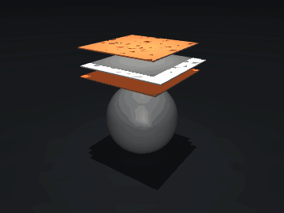</a></td>
  </tr>
  <tr>
    <td><a href="examples/mocap_gripper_control.py">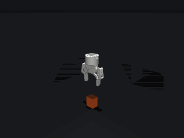</a></td>
    <td><a href="examples/velux_sealing.py">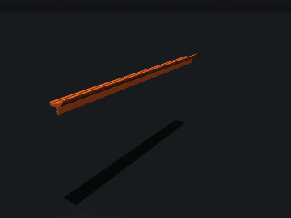</a></td>
    <td><a href="examples/physics/models/slider_crank/slider_crank.xml">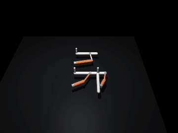</a></td>
  </tr>
  <tr>
    <td colspan="3" align="center"><a href="examples/bronchoscope.py">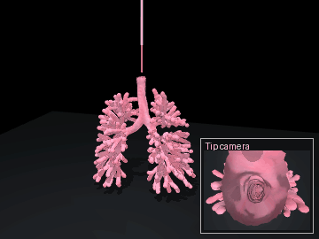</a></td>
  </tr>
</table>

[Usage](examples/GUIDE.md) · [Sources](examples/physics/models/UPSTREAM.md)

## Installation

Requires **MuJoCo 4.x** and **Python 3.11+**. This repository selects Python 3.12.
Install [Git LFS](https://git-lfs.com/) and [uv](https://docs.astral.sh/uv/),
then run from the repository root:

```bash
git lfs install
git lfs pull
uv sync --locked
uv run python examples/heterogeneous_cube.py
```

`uv run` uses the project's virtual environment and the local editable package.
For a simulation without a viewer, add `--headless`.
See the [MuJoCo guide](https://mujoco.readthedocs.io/) for graphics runtime requirements.

## Start exploring

```bash
uv run python examples/mj_xml.py drape
uv run python examples/physics_gallery.py --list
uv run python examples/rod_twist.py
```

Follow the [Python quick start](docs/quickstart/README.md) to build your own scene,
or browse the [example guide](examples/GUIDE.md) for robot manipulation, tactile
sensing, plastic deformation, and speculative contacts.

Upgrading an existing project? See the [migration guide](docs/migration/README.md).
Testing and IDE setup are covered in the [development guide](docs/development/README.md).
