# MuJoCo examples

Start with the **physics gallery** for self-contained physical systems. The gallery
only imports MuJoCo and NumPy, uses bundled XML assets, and works offline. The
remaining examples cover robotics, sensing, planning, and experimental modelling.
Existing script paths are retained so commands and external links keep working.

Run these commands from the repository root with the project environment:

```bash
uv run python examples/physics_gallery.py --list
uv run python examples/physics_gallery.py newton_cradle
uv run python examples/physics_gallery.py jelly --headless --duration 5
```

The gallery itself resolves assets relative to its source file and can also run
from another working directory. Most older examples expect the repository root.
Native viewer examples need a desktop display; headless gallery runs need no OpenGL
context. On macOS, use `uv run mjpython` in place of `uv run python` for the passive viewer.

## Physics gallery

All seven entries use the same launcher, `physics_gallery.py <name>`:

| Simulation | Animated preview | What to look for |
| --- | --- | --- |
| `newton_cradle` | 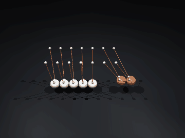 | Seven balls suspended by paired tendons. Two displaced balls start a chain of stiff impacts and momentum transfer. |
| `balloons` | 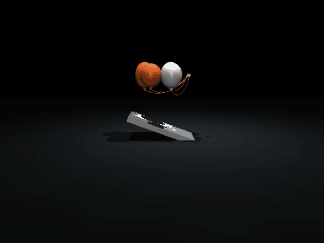 | Four helium balloons tied to a shared weight: approximate buoyancy, ellipsoid air drag, and string limits. |
| `slider_crank` | 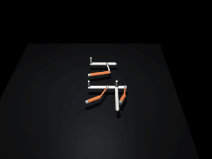 | Forward and reverse transmissions, plus a crank initially outside its valid geometry. |
| `muscle_arm` | 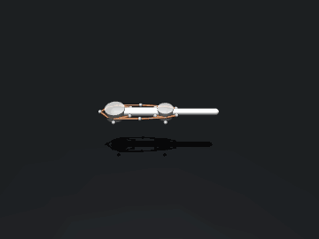 | Two links and six muscles. Alternating excitation pulls tendons around shoulder and elbow cylinders. |
| `adhesion` | 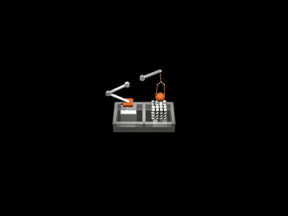 | An adhesive arm and pulley-mounted sphere. The winch lowers and raises the sphere while adhesion switches over particles. |
| `hammock` | 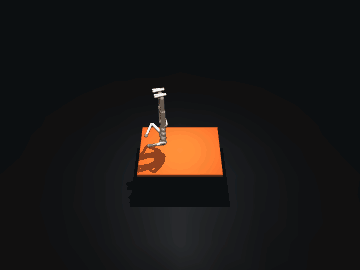 | A passive humanoid falls onto a pinned flex grid: impact, sagging, and load transfer to four corners. |
| `jelly` | 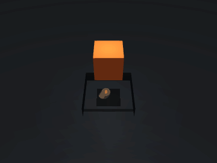 | An 8 × 8 × 8 volumetric flex grid falls, squashes, and settles around an inclined capsule. |

Controls and options:

- Drag to orbit the camera; scroll to zoom. Double-click a body, then Ctrl-drag to apply a perturbation. Close the window to exit.
- `--manual` disables demonstration inputs so the viewer's actuator sliders control the muscle arm, slider cranks, or adhesion mechanisms.
- `--speed 0.2` slows viewer playback for impacts; it does not change the physics timestep.
- `--headless --duration 8` simulates eight seconds, checks for non-finite states and runtime warnings, then exits. It works with every gallery entry.
- `--original-colors` restores the upstream appearance.

The gallery previews are actual four-second simulation rollouts, rendered at 20 fps.
Regenerate all documented previews with:

```bash
uv run --with pillow python examples/render_physics_gifs.py
```

On a headless Linux host, prefix the command with `MUJOCO_GL=egl`. Pass example
names to render a subset, for example `examples/render_physics_gifs.py jelly hammock`.
The exporter uses each example’s sequence duration by default; `--duration` overrides it.
The additional previews need their examples’ dependencies and supported MuJoCo versions.
Pillow is only required for export. The script resolves its default output directory
relative to its source file.

These are demonstrations of MuJoCo's modelling features. For example, the balloons
omit rubber mass and use a buoyancy approximation; the cradle uses deliberately
stiff contact settings and a 0.1 ms timestep. The broken slider crank is intentional.

The models are pinned to MuJoCo 3.3.7 and tested on 3.3.7 and 3.14.0. The jelly loader
selects the discrete integrator on newer versions that require it for flex elasticity.
On 3.14.0, compiling the hammock reports an upstream attachment timestep conflict;
the parent hammock's 1 ms timestep is retained. This is a compilation warning, not
a runtime instability.

Source, version, and Apache 2.0 licensing are recorded in
[physics/models/UPSTREAM.md](physics/models/UPSTREAM.md). Vendored XML is unchanged;
Python provides the palette, camera framing, and demonstration actuator inputs.

## Carbon and flame palette

Every visual example and the XML asset exporter use
[physics/palette.py](physics/palette.py). Most geometry stays
neutral, with orange reserved for selected bodies, tendons, and deformables.

| Color | Hex | Simulation role |
| --- | --- | --- |
| Carbon | `#111214` | Sky and haze |
| Charcoal | `#191b1e` | Ground planes |
| Raised charcoal | `#22252a` | Sky gradient |
| Off-white | `#f2f2ee` | Moving neutral bodies |
| Cool gray | `#adb0b5` | Fixed structures and markers |
| Light orange | `#ff8045` | Tendons, skins, and slider-crank visualizations |
| Flame orange | `#ff6b2b` | Selected bodies and flex objects |
| Graphite | `#36393e` | Available secondary structural tone |

`apply_palette(model, accents=("pusher",))` styles a compiled model before a renderer
or viewer opens. It retains transparency and detaches upstream geometry materials
so textures cannot tint the palette. The palette only changes rendering fields;
physical properties and collision settings are unchanged. Off-white and orange
keep start/goal and actual/target distinct; the admittance target is also box-shaped.
Layered cloth, live plots, browser overlays, and exported XML use the same palette.
The tactile sensor retains its diagnostic RGB response as sensor data.

## Luggage conveyor and carousel

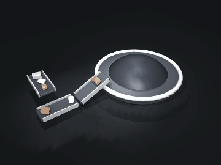

The conveyor follows the [requested reference video](https://www.youtube.com/watch?v=PdSdrqhSiZA):
three feeder belts, an incline, a circular carousel, guardrails, and six luggage shapes.
Bags move through native `surfacevel` contact friction, with no bag actuators.
This example needs **MuJoCo 3.11+** and keeps the carbon-and-flame palette.

```bash
uv run python examples/conveyor_belt.py
uv run python examples/conveyor_belt.py --headless --steps 10000
MUJOCO_GL=egl uv run --with pillow python examples/render_physics_gifs.py conveyor_belt --duration 16 --fps 10
```

Space reverses all moving surfaces, P stops/starts them, and Backspace resets all
bags. The preview is a 16-second rollout. The upstream model is bundled and
[attributed here](physics/models/UPSTREAM.md).

## More animated examples

These previews show existing simulations using their normal dynamics and control
sequences. They use the same carbon-and-flame palette as the physics gallery.

| Example | Animated preview | What to look for |
| --- | --- | --- |
| [`mj_xml.py`](mj_xml.py) | 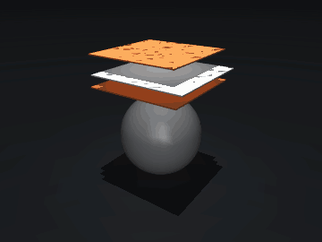 | Three elastic cloth layers fall over a sphere, drape, and contact one another. Flame, off-white, and light orange keep the layers distinct. |
| [`particle_container.py`](particle_container.py) | 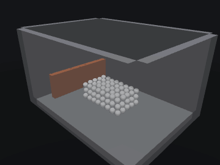 | An orange paddle stirs 120 damped particles inside a transparent container (`--particles 128` selects this grid). |
| [`velux_sealing.py`](velux_sealing.py) | 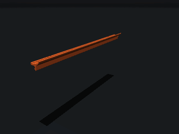 | Repeated profile segments bend and settle under gravity. |
| [`mocap_gripper_control.py`](mocap_gripper_control.py) | 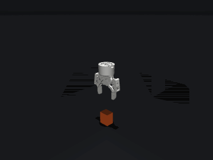 | The full 14-second sequence: approach, close fingers, lift, then rotate the box. Run with `--auto` to reproduce it. |

The cloth and sealing previews run for three seconds, stirring for seven, and the
gripper for fourteen. These GIFs use 10 fps. Regenerate just these previews with:

```bash
MUJOCO_GL=egl uv run --with pillow python examples/render_physics_gifs.py mj_xml particle_container velux_sealing mocap_gripper_control --fps 10
```

The gripper uses `robot_descriptions` and may download its model on first use.

## More physical systems and deformables

| Script | Simulation | Notes |
| --- | --- | --- |
| `conveyor_belt.py` | Three feeder belts deliver six bags to a circular luggage carousel using native surface-velocity contact friction | MuJoCo 3.11+; Space reverses, P stops/starts surfaces, Backspace resets; `--headless`. |
| `particle_container.py` | Damped particles stirred by a moving paddle | `--headless`; `--particles` selects approximate count. |
| `mk_flex.py` | Rope, cloth, soft cube, custom mesh flex, and composite cable | `--headless`; requires the newer `make_flex` API (MuJoCo 3.10+). |
| `velux_sealing.py` | Flexible sealing strip built from repeated mesh segments | `--headless`; bundled profile mesh. |
| `earth_digger.py` | Excavator linkage with slider-crank hydraulic transmissions | Native viewer. |
| `mj_tendon_finger.py` | Experimental deformable bunny under an actuated press | Native viewer; newer flex features. |
| `mj_xml.py` | Inline XML experiments for bags and draped deformables | Edit the selected XML in the script; newer flex features. |
| `modelling.py` | Robotiq gripper, bunny, cable, cloth, jello, and free ball | Downloads robot descriptions when uncached. |
| `deformable_assets.py` | Generate cable and cloth specs and export XML | Utility example. |
| `dlo-insert.py` | Cable insertion into a pipe | Viser browser viewer. |

## Robotics and control

Robot examples using `robot_descriptions` may download their model assets on first
run. Some advanced examples need newer MuJoCo APIs than the package minimum.

| Script | Demonstration |
| --- | --- |
| `sim.py` | Minimal UR5e and Robotiq gripper scene in a passive viewer. |
| `robot.py` | UR10e and gripper using the `mjsim.Robot` wrapper and keyboard callbacks. |
| `ur5e_control.py` | Despite its filename, a UR10e tool force/torque sensor scene with optional gripper and poking finger. |
| `mocap_gripper_control.py` | Actuated gripper base picks up, lifts, and rotates a box. Starts with manual controls; `--auto` or `--headless` runs the sequence. |
| `admittance_controller_gui.py` | UR admittance controller with a contact pusher and interactive controls; see [the controller report](report.md). |
| `admittance_controller.py` | Convenience entry point for the admittance demo. |
| `ur10e_dmp_cartesian.py` | Fit a Cartesian DMP to the bundled CSV demonstration and play it on a UR10e. |
| `controller_dmp.py` | Fit and sample a Cartesian/quaternion DMP without running a simulation. |
| `cartesian_planning.py` | UR10e Cartesian path playback around an obstacle. |
| `planner_rrt.py` | Minimal OMPL RRT-Connect in joint and task space. |
| `grasping_force_closure.py` | Toy grasp matrices and friction cones. |
| `ik_stub.py` | IK control flow using a lightweight stand-in backend. |

## Sensors and viewers

| Script | Demonstration |
| --- | --- |
| `camera_capture.py` | Fixed camera in a box scene; `C` displays a capture with OpenCV. |
| `gelsight_demo.py` | GelSight-style tactile sensor with a spherical indenter; `G` displays images. |
| `mocap_sensor.py` | Welded free-body load: compare site force sensor readings with constraint wrenches. |
| `mocap_sensor_api.py` | Box welded to a mocap load cell through a reusable force/torque helper; `--headless`. |
| `mocap_sensor_dlo.py` | Hanging cable welded to a mocap load cell with force and torque readings. |
| `mocap_rod_wall_force_plot.py` | Welded rod pushed into a wall, measuring and optionally plotting force; `--headless`. |
| `viser.py` | Unitree G1 scene served by `mjviser` at `http://localhost:8080`. |

`test.py` is a local scratch scene with UR10e, gripper, ball, and an optional
machine-specific Harting connector mesh. Start with a catalogued example above
for a reproducible demonstration.

## Overlap and palette review

The [complete example review](REVIEW.md) covers all scripts, their overlapping
purposes, and current palette coverage. The main cleanup candidates are the
near-duplicate `test.py` / `robot.py` pair, the convenience admittance wrapper,
and shared load-cell helpers spread across the force demos. The DMP, planning,
and deformable examples also have related themes, but demonstrate distinct APIs
or physical systems.

All displayed scenes and exported deformable assets now use the shared palette.
The four numerical-only examples have no geometry to theme. The review records
marker roles and the intentional distinction between scene styling and diagnostic
sensor responses.
