# Examples

The package targets MuJoCo 4.x. Start with the [MuJoCo 4 feature guide](GUIDE.md#mujoco-4-features)
for native rod torsion, plasticity, speculative contacts, and CPU batching.

Run these commands from the repository root using `uv run`. It selects the
project environment and synchronizes the dependencies declared in
`pyproject.toml` and `uv.lock`; no virtual-environment activation is needed.

[Snap fit](snap_fit.py): a V-shaped friction clip, built with `MjSpec`.
A lid pivots on the left, while a V spring on the right holds it through contact
pressure and friction. Its 44 short box segments have damped revolute joints,
with 24 segments around a tight 3 mm bottom radius and an angled free leg.
There are no hooks or undercuts.

```bash
uv run python examples/snap_fit.py
```

An orange mocap handle carries a rounded finger and a three-axis force sensor.
Double-click the **orange handle**, then **Ctrl + right-drag** to move it. For
precise positioning, **A/D** moves left/right, **W/S** up/down and **Q/E** in depth,
in 0.5 mm steps. The finger starts just to the right of the release tab.

The overlay plots total force magnitude and the leftward pressing component in
newtons over five seconds. Its peak reading samples every physics step. The
sensor measures the rigid finger's support load, with its static weight removed;
it includes contact with any part of the mechanism. **R** clears history and peak.
Press **P** to play/replay the opening plan from the closed state. It resets the
model and force history, settles for a second, presses the tab over two seconds,
holds for a second, then opens the lid over five seconds. The finger follows the
actual lid angle. Opening uses a separate hinge torque capped at **0.045 N m**;
the plot measures only the finger load, not this hinge torque. The plan holds
the lid open at the end. **X** stops the plan; a manual movement key also stops it.
Before P is pressed, the model remains under manual control. Spring rigidities
are `SUPPORT_RIGIDITY` and `CLIP_RIGIDITY` near the top of the file. These are illustrative simulation forces, not calibrated
hardware measurements.

[Opening video with force graph](media/snap_fit_opening.mp4) (720p, 30 fps).
Regenerate it, the README GIF, and a CSV of the sensor readings using the same opening
plan as the viewer:

```bash
MUJOCO_GL=egl uv run python examples/render_snap_fit.py
```

The simulation, video, and GIF use the shared carbon-and-flame palette. The GIF
focuses on the mechanism for readability in the README table. The exporter
requires `ffmpeg`. The larger viewer graph uses thicker lines;
the finger weld uses a 1.5 ms response time and higher constraint impedance.


[Airway and tendon-driven bronchoscope](bronchoscope.py): a flexible shaft above
the tracheal inlet, with a translating, rotating base and a thinner tip steered by
four pulling tendons. A lit camera at the tip provides a live video inset.

```bash
uv run python examples/bronchoscope.py
uv run python examples/bronchoscope.py --manual
uv run python examples/bronchoscope.py --auto
uv run python examples/bronchoscope.py --show-collision
uv run python examples/bronchoscope.py --no-collision
uv run python examples/bronchoscope.py --headless --auto --duration 28
MUJOCO_GL=egl uv run python examples/bronchoscope.py --headless --auto --camera-output /tmp/bronchoscope-tip.png
```

Regenerate the simulation-table preview, including its tip-camera inset:

```bash
MUJOCO_GL=egl uv run --with pillow python examples/render_physics_gifs.py bronchoscope --fps 10
```

The simulation starts in **manual control**, with the tip 12 mm above the inlet,
and waits for your input. `--manual` is also accepted explicitly. The optional
`--auto` demo waits two seconds, then advances the base 60 mm over 24 seconds
with a smooth start and stop, and holds about 48 mm inside the upper trachea.
This demonstration stops before navigating the bronchial branches.

Use **C** to switch the main viewport between the external and tip cameras,
and **V** to hide/show the live inset. The camera has a 90-degree vertical field
of view, a light on the last tip segment, and a near clipping distance of 0.1 mm.
It moves and bends with the tip. The inset updates at approximately 10 Hz;
`--camera-output` saves the final headless camera frame and needs an OpenGL backend
such as EGL on Linux. Ordinary headless simulation needs no graphics context.

Use **Up/Down** to translate the base by 5 mm along the entry axis, **Left/Right**
to rotate it by 0.1 rad, and **W/S** or **A/D** to increase the opposing X or Y
tendon tensions by 0.05 N.
The depth joint and actuator allow **250 mm of insertion** and **100 mm of
retraction** from the initial pose (`base_height`: −0.25 to +0.10 m). Negative
commands advance the scope. The status display shows the 250 mm manual limit.
Steering directions are relative to the rotating base. Each steering key releases
the opposite tendon. **Space** releases all tendons, **R** resets to manual control,
**P** pauses, and **T** stops/resumes automatic insertion from the current depth.
**B** toggles the collision surface overlay. The status line reports airway-wall
contact count and summed normal contact force in newtons.
Manual movement or tendon input stops automatic insertion. The native viewer's
actuator sliders also expose translation (metres), rotation (radians), and the
four independent tendon tensions (0–0.6 N). Turn automatic insertion off with
**T** before using sliders. Headless mode also defaults to manual control;
add `--auto` to run the insertion sequence. Both modes check for simulation warnings.

The default asset is the OBJ in `examples/assets/airways`; paths resolve relative
to the script, so the example also runs from other working directories. The OBJ's
MTL supplies diffuse color, opacity, approximate specular/shininess, and its diffuse
texture. JPEG textures are converted to PNG in memory; the source assets are
untouched. A missing texture emits a warning and falls back to the MTL color.
Use `--airway PATH --airway-scale 0.001` to override the asset or its units.
The default assumes millimetres, preserves orientation, centers the airway in X/Y,
and places its lowest point 15 mm above the floor.

The supplied hollow airway is sealed at its top. The example opens an inlet by
discarding faces touching the top 5 mm in a virtual OBJ copy, preserving the UVs
and materials. It estimates an entry axis from the upper trachea and aligns the
scope with that slightly inclined axis. These operations assume the supplied
upright anatomy. They do not alter any source asset files. Mesh-triangle ray
queries check radial clearance along the planned route and shorten the travel
if a narrowing, bend, or obstruction is detected.

The detailed OBJ/MTL is used only for rendering. The matching
`hollow_airway_collision.obj` is an inner-wall collision surface with **4,999
triangles**, loaded as a **rigid 2D flex** pinned to the world. It preserves the
non-convex inner passages and adds no motion degrees of freedom. Triangles have
a 0.1 mm contact radius, sliding friction is 0.3, and self-collision is disabled.
The collision inlet is opened at the same plane as the visual inlet before
decimation; its coordinate system, units, and registration are preserved.
The original outer wall is omitted from collision geometry because this example
models insertion inside the lumen. The textured visual model retains both walls.

`--collision PATH` selects another collision-only OBJ with the same coordinates
and units. Without that flag, the example looks for a sibling named
`<visual_stem>_collision.obj`. A custom visual asset without a matching sibling
runs without airway contact; startup output states whether contact is enabled.
`--no-collision` provides the earlier visual-only behavior for comparison.

The shaft is 280 mm long and 6 mm in diameter; the distal section is 60 mm long
and 4.8 mm in diameter. This is a discrete elastic rod with passive ball-joint
springs (20 shaft segments, 8 tip segments), with a softer distal section. Four
spatial tendons run through guides around the tip and are actuated in tension;
the tip bends from tendon forces rather than prescribed joint angles. Dimensions,
stiffness, damping, and tension limits are illustrative and editable in the script.
The links compensate gravity to keep the soft rod from sagging away from the
entry axis; tendon forces still bend the rod dynamically.
The tendon routing starts at the distal section, approximating a sheathed drive
through the shaft. Airway walls are fixed, and native contact forces resist
steering into them. This is an illustrative contact setup, with uncalibrated
friction, stiffness, and damping; it does not model airway tissue deformation.

The 5k mesh allocates detail by region. Inward normal/cone rays estimate local
lumen width on the inner surface. A surface graph finds wide regions connected
to the inlet, using a 6.5 mm priority threshold (6 mm shaft plus 0.5 mm clearance).
These are priorities for approximation, not a proof that the entire scope can
navigate those branches. Distal branches retain coarse collision geometry.

The inner surface is first reduced to 37,999 triangles. Its priority-region and
inlet vertices are then frozen, and Blender collapses the remaining distal
geometry until the complete collision surface is below the 5,000-triangle limit.
This avoids spending most of the budget on small distal features. The exporter
fails if protected geometry prevents meeting the requested triangle budget.

Reproduce the region selection, Blender reduction, and collision experiment:

```bash
# Prepare source-coordinate regions and high-resolution reference probes.
uv run python examples/prepare_airway_regions.py --output /tmp/airway-regions.npz
# Generate the default 5k mesh (Blender 4.0+; original OBJ untouched).
blender --background --factory-startup --threads 4 --python-exit-code 1 --python examples/decimate_airway.py -- --regions /tmp/airway-regions.npz --triangles 5000 --protect-after 38000
# Compare regional geometry and tendon-driven contact without OpenGL.
uv run python examples/validate_airway_collision.py --meshes examples/assets/airways/hollow_airway_collision.obj --regions /tmp/airway-regions.npz --report /tmp/airway-collision-validation.json
```

The [5k validation results](assets/airways/collision_validation.json) use Blender
4.0.2 Collapse decimation. The original has 1,114,842 triangles; extracting and
opening its inner wall leaves 450,959 before simplification. The default
collision OBJ is about 168 KB. Regional errors use 50,000 area-weighted surface
samples and report the larger RMS/percentile from the two directions. These are
sampled errors, not certified whole-surface bounds.

| 5k collision strategy | Priority-region RMS error | Priority-region 95th percentile | Priority-region 99th percentile |
| --- | --- | --- | --- |
| Uniform inner-wall decimation | 0.634 mm | 1.289 mm | 1.754 mm |
| Two-stage region protection (default) | 0.164 mm | 0.227 mm | 0.718 mm |

The sampled regional maximum error is 2.60 mm, so the improvement in typical
error is not a guarantee of uniformly accurate branch transitions. Whole-mesh
errors include intentionally omitted outer walls and heavily simplified distal
features and are not the acceptance metric for this collision surface.

Across 1,440 radial queries along the insertion route, all rays hit the collider.
The radial RMS difference from the original was 0.068 mm and the maximum was
0.254 mm. Minimum measured lumen radius was 6.31 mm, leaving room for the 3 mm
shaft radius. Across 300 additional priority-region centers, all retain clearance
for the 4.8 mm tip and 297 retain clearance for the full 6 mm shaft. Minimum
measured clearance was 2.77 mm. All 4,622 local reference rays hit the collider;
95% of first-hit distance errors were below 0.294 mm. Three centers losing full
shaft clearance and larger errors near transitions remain limitations for deeper
navigation. The saved [original-surface probes](assets/airways/collision_priority_probes.json)
support regression checks for tip clearance and regional ray accuracy.

In four separate steering directions at 60 mm insertion, ramping a tendon to
0.6 N produced sustained wall contact, limited lateral tip motion to about
4.8–8.2 mm versus 24.1 mm with collisions disabled, and kept measured peak
penetration below 0.058 mm. After release, tip error was below 0.8 mm within two
seconds. These tests completed without MuJoCo warnings. Timings exclude
rendering and use a 1 ms physics step with 100 Hz control/measurement on this
machine; they are not hardware-independent benchmarks. The viewer and headless
runner use the same 100 Hz control rate.

The 5k mesh ran at **2.21–2.75× real time** in the headless contact tests, compared
with 0.21–0.22× for the previous 100k collider: roughly a tenfold improvement.
The earlier dense-mesh comparison files and their archived report are local
experiment outputs excluded by `.gitignore`. Regenerate those optional meshes
with the following command, then select one with `--collision PATH`:

```bash
blender --background --factory-startup --threads 4 --python-exit-code 1 --python examples/decimate_airway.py -- --triangles 50000 100000 --output-dir /tmp/airway-decimation
```

The default 5k version meets the budget and supports real-time physics here,
while preserving the upper-tracheal contact behavior. Dynamic validation covers
the upper trachea; the regional geometry probes extend into larger branches but
are not dynamic navigation tests.

[Simplified forearm indentation](forearm_indentation.py): two separate rigid
**radius and ulna** shapes surrounded by bonded **muscle, fat, and skin**.
A rounded probe gently indents 1 mm above the radius, releases, then repeats
between the bones. The native MuJoCo viewer shows measured upward probe force
and a live force–indentation graph for both locations.

```bash
uv run python examples/forearm_indentation.py
uv run python examples/forearm_indentation.py --headless --csv /tmp/forearm.csv
uv run --extra dev pytest tests/test_forearm_indentation.py
```

Press **1** to hide/show skin, **2** for fat, **3** for muscle, **E** for mesh
edges, **P** to pause, and **R** to restart. Layers start translucent; hiding all
three reveals the two bones. These switches affect visualization only. CSV
export contains time in seconds, measurement site, phase, indentation in metres,
and signed world-z probe reaction in newtons. Positive force is upward.

The illustrative geometry is a 20 cm long elliptical segment, initially 7 cm
wide and 5.2 cm thick, narrowing by 15% toward one end. The skin layer is 1.5 mm
thick and the fat layer 4 mm thick along the proximal ellipse's principal axes;
both taper with the segment. The cross-section has 24 sectors and two separate
eight-sided bone cavities. Shared interface vertices bond the three tissue
meshes, while vertices on each bone are fixed children of that rigid bone.
The bones and both end faces are supported, and gravity is disabled. The probe
is a frictionless 12 mm radius sphere driven by smooth position trajectories.

Material parameters used in this example:

| Region | Density (kg/m³) | Young's modulus (kPa) | Poisson's ratio |
| --- | ---: | ---: | ---: |
| Bone | 1908 | Rigid | — |
| Muscle | 1090 | 30 | 0.40 |
| Fat | 911 | 1.9 | 0.45 |
| Skin | 1109 | 210 | 0.40 |

Densities come from the [COMSOL Bioheat Materials Library](https://doc.comsol.com/6.4/doc/com.comsol.help.comsol/comsol_ref_materials.25.73.html).
Skin and fat modulus magnitudes come from the resting-forearm fit reported by
[Iivarinen et al. (2011)](https://pubmed.ncbi.nlm.nih.gov/21696992/). Transferring
those values into this different geometry and Saint Venant–Kirchhoff model does
**not** reproduce that study's calibration. Muscle stiffness, Poisson ratios,
and the 0.0001 s elastic damping coefficient are demonstration assumptions.
Mass is accumulated from each tetrahedron's own tissue density; density is not
used as a substitute for stiffness and has little influence on the settled,
gravity-free indentation response.

The simulation uses MuJoCo 3.17's `discrete` integrator, CG solver, and a 0.2 ms
timestep to accommodate the thin, stiff skin. The sequence lasts 13 simulated
seconds; physics work is budgeted per viewer frame, so execution can be slower
than real time. Measurements are sampled at 20 Hz, after refreshing the actual
contact solution. Zero indentation is calibrated separately at each site against
the undeformed faceted skin, accounting for the probe radius. The headless check
rejects solver warnings, nonpositive sampled element volumes, absent hold
forces, or failed recovery. The tests also check mass, material-interface
conformity, fixed bone attachments, graph data, and CSV output.
In the checked configuration, settled reactions are approximately 0.55 N above
the radius and 0.56 N between the bones at 1 mm indentation. These are outputs
of this particular coarse model, not reference values for a human forearm.

This is an **illustrative passive mechanics model**, not a patient-specific or
clinically validated forearm. It omits muscle activation, tissue sliding,
ligaments, the interosseous membrane, vessels, nerves, and joint motion. Its
compressibility and coarse mesh are intentional simplifications. Force values
depend on geometry, boundary conditions, material assumptions, and mesh
resolution; neither measurement site is assumed in advance to be stiffer.
Medical predictions would require appropriate constitutive laws, mesh and
timestep convergence studies, and validation against measurements.

[Cylinder with a stiff core and soft coat](heterogeneous_cylinder.py): a solid
12 cm tall cylinder, with a **blue 3 cm radius core (25 kPa)** surrounded by an
**orange coat extending to 6 cm radius (5 kPa)**. Both regions have density
1000 kg/m³ and extend the full height; there are no soft end caps. The coat is
translucent so the core is visible. Press **C** to hide/show the coat without
changing physics, **P** to pause, **R** to repeat, or **E** to show mesh edges.

```bash
uv run python examples/heterogeneous_cylinder.py
uv run python examples/heterogeneous_cylinder.py --headless
```

The circular cross-section is approximated with 16 sectors and extruded into
four axial layers: 165 vertex bodies and 576 tetrahedra. The two material regions
share all 80 interface vertices, creating a bonded radial boundary with no
overlapping volumes. Mass is accumulated from the volume of each tetrahedron.
The scene reuses the cube's slow compression/release cycle, clamped bottom,
zero gravity, and native MuJoCo viewer.

Unlike the stacked cube layers, the core and coat sit beside each other under
the plate, so they have similar axial shortening. At the settled hold, both
shorten approximately **6.65%**, while the mean axial elastic stress is about
**1.39 kPa in the core** and **0.28 kPa in the coat**. The readout reconstructs
Saint Venant–Kirchhoff elastic stress from the simulated vertex positions;
it excludes damping/contact impulses and is not an instantaneous plate-force
sensor. After release, residual vertex displacement is approximately 0.003 mm.
The headless run checks load sharing, recovery, warnings, and sampled element
volumes. Mesh conformity, shared interface masses, and stress reconstruction
are covered in `tests/test_heterogeneous_cylinder.py`.

[Heterogeneous deformable cube](heterogeneous_cube.py): a 12 cm cube with an
**orange soft upper half (5 kPa)** bonded to a **blue stiff lower half (25 kPa)**.
Both have density **1000 kg/m³**. A plate slowly compresses the cube by 8 mm,
holds, and lifts away. The native MuJoCo viewer reports each layer's percentage
shortening; press **P** to pause, **R** to repeat, or **E** to show mesh edges.

```bash
uv run python examples/heterogeneous_cube.py
uv run python examples/heterogeneous_cube.py --headless
```

The cube has 125 vertex bodies and 384 tetrahedra, split into two 3D flexes with
different Young's moduli. Their 25 interface vertices reference the **same
bodies**, so the material regions cannot separate. Mass is computed from each
tetrahedron's volume and density and accumulated at its vertices, including
both regions' contributions at the interface. Contact between the bonded flexes
is disabled; the plate interacts with them through frictionless contact.

The lower face is clamped and gravity is disabled to isolate the imposed load.
The 13-second load/release cycle uses smooth plate motion. In the validated run,
the soft layer shortens approximately **11.1%**, versus **2.2%** for the stiff
layer, and all vertices return within 0.1 mm of their starting positions after
release. The headless check also checks recovery, simulation warnings, and
sampled tetrahedron volumes for inversion. A uniform-stiffness control is
included in `tests/test_heterogeneous_cube.py`.

This first example varies **stiffness**, with equal density throughout. The
dimensions and material properties are class constants near the top of the
script. It uses MuJoCo's [Saint Venant–Kirchhoff flex elasticity](https://mujoco.readthedocs.io/en/3.11.0/XMLreference.html#flex-elasticity)
with Poisson's ratio 0.25; it is an illustrative elastic solid, not a calibrated
foam model for crushing or permanent deformation. Uses the `discrete` integrator
required by current flex elasticity; validated with MuJoCo 3.17.0.

[Shadow Hand tactile jar](shadow_hand_jar.py): red fingertip caps, 85 STF-inspired
3D force taxels at 100 Hz, and a damped rotating lid. Run `uv run python examples/shadow_hand_jar.py`.
Add `--ik` for MINK fingertip tracking with draggable targets.

[Robotis HX5-D20 tactile jar](robotis_hand_jar.py): a separate copy of the jar
scene using the Robotis hand's 20 actuators and five native 3×3 normal-force
tactile grids. Run `uv run python examples/robotis_hand_jar.py`; add `--ik` for
draggable fingertip targets or `--headless` for a smoke check. C/O curl/open,
Up/Down move the mount, T toggles sensing volumes, and P prints readings. A live
overlay displays all 45 taxels in newtons. See the [model notes](assets/robotis_hand/UPSTREAM.md)
for controls, sensor interpretation, and provenance. The lid remains passive;
there is no automatic grasp/turn sequence.

[Closed cable knot recognition](dlo_knot.py): four capsule cables displayed
in two rows in one native MuJoCo scene: **unknot** (blue), **trefoil** (orange),
**figure-eight** (purple), and **overhand** (yellow). Each has ball joints and its own **connect
equality between endpoint sites**. No knot-selection flags are needed:

```bash
uv run python examples/dlo_knot.py
uv run python examples/dlo_knot.py --headless --steps 500
```

The overhand is shown with a gray **physical outer return arc** joining its
tails. With this closure it has trefoil topology, so its readout intentionally
says `detected=trefoil`. It is a different presentation of the same knot type,
not a fourth invariant. `is_target_knot(points, target="overhand")` therefore
aliases the trefoil target for closed curves. This does not add general
open-cable classification. See [MathWorld: Overhand Knot](https://mathworld.wolfram.com/OverhandKnot.html).

Each cable has a scene label and live classification readout. Press **D** to
disturb all cables, **R** to reset all, and **P** to pause/resume. Older MuJoCo
versions without text overlays print classification to the terminal. Green
markers identify the closures. Zero gravity and weak joint springs make the
initialized shapes easy to inspect; these are educational articulated cables,
not calibrated elastic rods. `--segments` controls resolution per cable
(default 48, minimum 24). Physics work is budgeted per frame to keep the viewer
responsive; larger segment counts or slower hardware may advance simulation
time slower than real time.

The reusable API accepts ordered world-space centerline vertices:

```python
from mjsim.utils.knots import is_target_knot, classify_closed_knot

matches = is_target_knot(body_positions, target="trefoil")  # Python bool
result = classify_closed_knot(body_positions)  # label, fingerprint, crossing counts
```

The last-to-first edge is implicit. The example samples cable body origins in
chain order and includes the final tip when necessary; it refuses to classify
when the physical closure gap exceeds 0.1 mm. Do not pass an open cable to this
API expecting automatic virtual closure.

Classification uses magnitudes of the Alexander polynomial at roots of unity
of orders 2, 3, and 4, requiring three projection directions to agree. The
fingerprints are `(1, 1, 1)`, `(3, 2, 1)`, and `(5, 4, 3)` respectively.
Self-intersecting/degenerate geometry and inconclusive calculations raise
`KnotClassificationError`; an unmatched fingerprint yields `result.knot=None`.
The boolean is a **fingerprint match**, not a proof of knot equivalence. Other
knots may share these values, and mirror images are intentionally grouped.
No KMT simplification or open-cable closure is included in this first example.

[Mocap overhand tying](dlo_tie_overhand.py): a native MuJoCo scene starting
with a **straight, stress-free 1.6 m cable**. Its elastic reference stays straight
throughout the trial. The green endpoint gripper remains fixed; the blue gripper
compresses and axially twists the cable to form a loop, threads through
its measured opening, then pulls through and holds the knot. No fixture,
precurved reference, intermediate body targets, or cable-position playback is
used in this default mode.

```bash
uv run python examples/dlo_tie_overhand.py
uv run python examples/dlo_tie_overhand.py --headless
uv run python examples/dlo_tie_overhand.py --preformed  # earlier preformed-loop version
```

Press **P** to pause/resume or **R** to reset. After a one-second straight hold,
loop formation takes 12 simulation seconds. The next two 0.6-second motions
approach and thread the opening; a 1.5-second pull-through precedes the final
hold. Compared with the original timing, approach/insertion peak speeds are
halved and their peak accelerations are reduced by 75%. The default headless trial lasts **22 simulation seconds**. Frame budgets
keep the viewer responsive, so wall-clock time can be longer on slower machines.

The straight-start model uses 40 capsule segments and **endpoint welds** so the
mocap handles transmit orientation as well as position. It starts with zero
spring force. The working end rotates 540 degrees while the endpoint spacing
is reduced; the threading plane is estimated from the actual simulated loop.
The threading motion still uses inertia to keep the opening available briefly.
The model uses a 1 ms timestep, self-contact, and a 1 mm contact margin. This is
a tuned, zero-gravity demonstration for this cable, not a general-purpose
knot-tying planner or calibrated rope/gripper model.

The visible gray return is **virtual**, using the closed overhand example's
cosine/sinusoidal arc convention with a fixed world-space bow (0.5 m for the
larger straight-start scene). It adapts to the measured endpoints and has no
collision geometry or forces. Detection samples the actual cable positions
at **5 Hz in simulation time**, rejects intersections or return clearance below
5 mm, and requires **five consecutive valid trefoil matches**. Tracking error
above 2 mm also invalidates a sample; this can occur during threading.
Invalid samples reset the streak and turn the return red. The readout reports
current success separately from the first success timestamp. In the validated
straight-start run, stable success first appears around **16.0 seconds**.

The optional `--preformed` mode retains the earlier 16-second experiment with
position-only endpoint connections. Its startup withdraws the tip from the
existing overhand core, makes the unknotted preform its spring reference, and
settles it before the visible trial. That preparation is not used in the
default straight-start mode.

Success is conditional on the displayed closure convention. A collision-free
virtual return is not universally topology-neutral; a topology transition can
pass through an invalid closure interval. The headless command fails if the
trial does not finish with stable success. Regression tests verify the straight
initial geometry, zero initial spring force, unchanged spring references,
stationary-gripper behavior, physical segment separation during threading,
and a sustained final trefoil match. No optional knot-analysis package is needed.

<table>
  <tr>
    <td><a href="physics/models/extended/sleep/dominos.xml">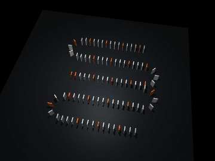</a></td>
    <td><a href="physics/models/replicate/newton_cradle.xml">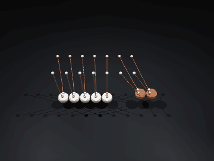</a></td>
    <td><a href="physics/models/extended/car/car.xml">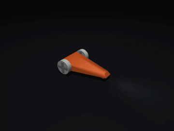</a></td>
  </tr>
  <tr>
    <td><a href="physics/models/extended/plugin/sdf/gear.xml">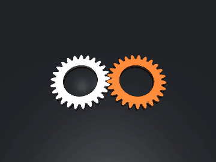</a></td>
    <td><a href="physics/models/extended/plugin/sdf/nutbolt.xml">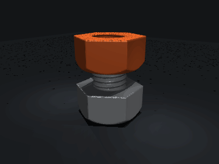</a></td>
    <td><a href="physics/models/extended/cube/cube_3x3x3.xml">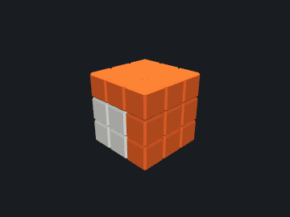</a></td>
  </tr>
  <tr>
    <td><a href="physics/models/extended/flex/flag.xml">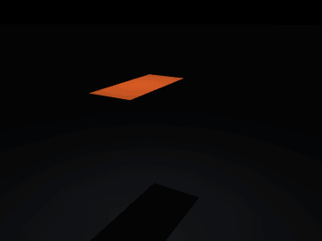</a></td>
    <td><a href="physics/models/extended/flex/trampoline.xml">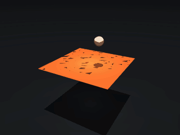</a></td>
    <td><a href="physics/models/hammock/hammock.xml">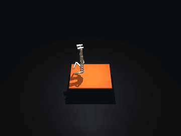</a></td>
  </tr>
  <tr>
    <td><a href="physics/models/extended/flex/basket.xml">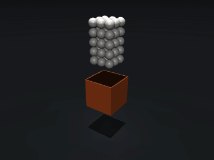</a></td>
    <td><a href="physics/models/flex/jelly.xml">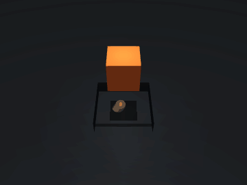</a></td>
    <td><a href="physics/models/extended/flex/gripper_trilinear.xml">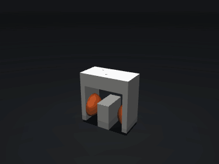</a></td>
  </tr>
  <tr>
    <td><a href="physics/models/extended/flex/pulley.xml">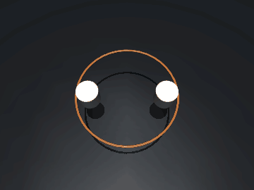</a></td>
    <td><a href="physics/models/extended/flex/coil.xml">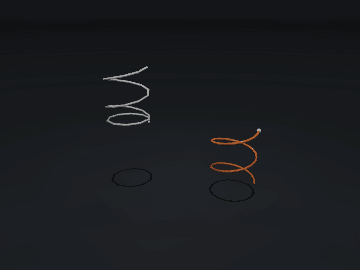</a></td>
    <td><a href="physics/models/tendon_arm/arm26.xml">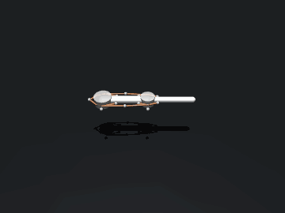</a></td>
  </tr>
  <tr>
    <td><a href="physics/models/balloons/balloons.xml">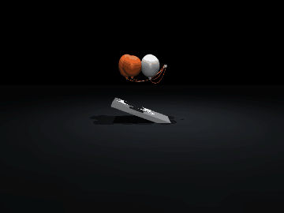</a></td>
    <td><a href="physics/models/adhesion/active_adhesion.xml">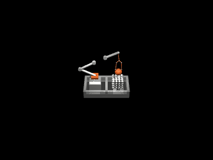</a></td>
    <td><a href="physics/models/extended/surfacevel/treadmill.xml">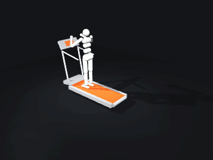</a></td>
  </tr>
  <tr>
    <td><a href="conveyor_belt.py">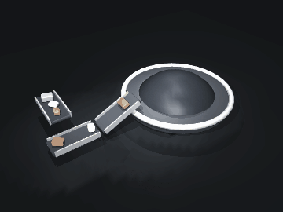</a></td>
    <td><a href="particle_container.py">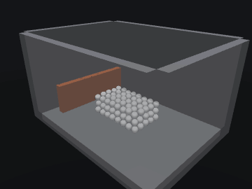</a></td>
    <td><a href="mj_xml.py">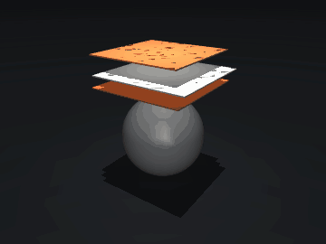</a></td>
  </tr>
  <tr>
    <td><a href="mocap_gripper_control.py">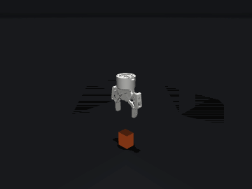</a></td>
    <td><a href="velux_sealing.py">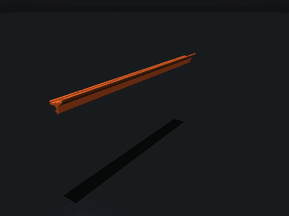</a></td>
    <td><a href="physics/models/slider_crank/slider_crank.xml">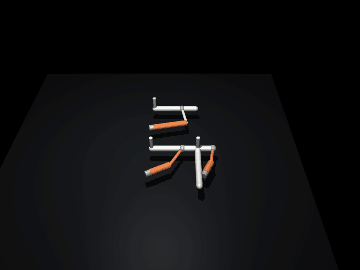</a></td>
  </tr>
  <tr>
    <td><a href="bronchoscope.py">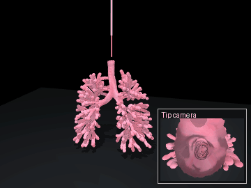</a></td>
    <td><a href="snap_fit.py">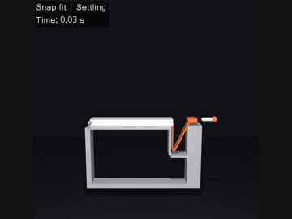</a></td>
    <td></td>
  </tr>
</table>

[Usage](GUIDE.md) · [Sources](physics/models/UPSTREAM.md)
