# Examples

<table>
  <tr>
    <td><a href="physics/models/extended/sleep/dominos.xml">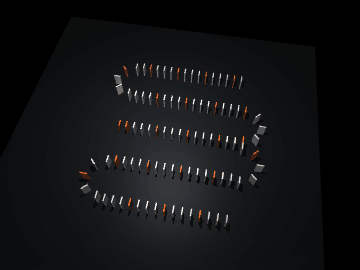</a></td>
    <td></td>
    <td><a href="physics/models/extended/car/car.xml">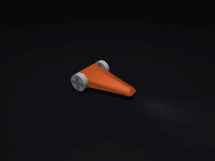</a></td>
  </tr>
  <tr>
    <td></td>
    <td><a href="physics/models/extended/plugin/sdf/nutbolt.xml">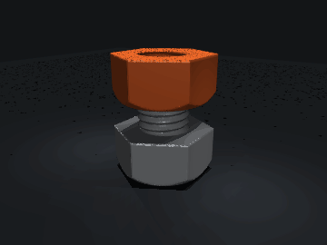</a></td>
    <td><a href="physics/models/extended/cube/cube_3x3x3.xml">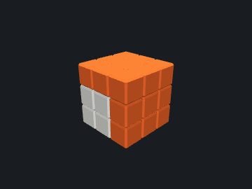</a></td>
  </tr>
  <tr>
    <td><a href="physics/models/extended/flex/flag.xml">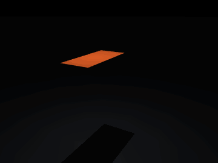</a></td>
    <td><a href="physics/models/extended/flex/trampoline.xml">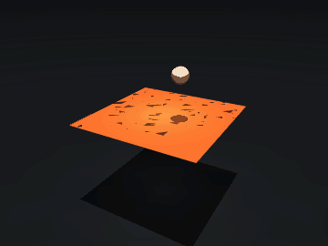</a></td>
    <td></td>
  </tr>
  <tr>
    <td><a href="physics/models/extended/flex/basket.xml">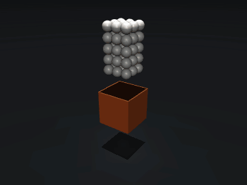</a></td>
    <td></td>
    <td><a href="physics/models/extended/flex/gripper_trilinear.xml">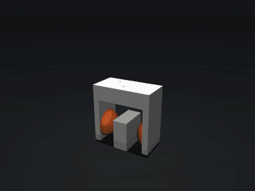</a></td>
  </tr>
  <tr>
    <td><a href="physics/models/extended/flex/pulley.xml">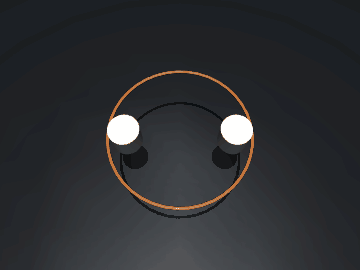</a></td>
    <td><a href="physics/models/extended/plugin/elasticity/coil.xml">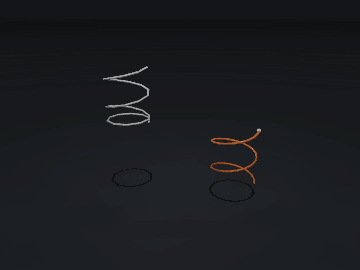</a></td>
    <td></td>
  </tr>
  <tr>
    <td></td>
    <td></td>
    <td><a href="physics/models/extended/surfacevel/treadmill.xml">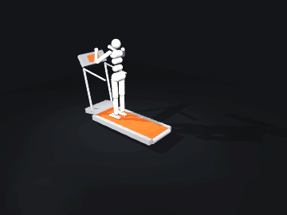</a></td>
  </tr>
  <tr>
    <td></td>
    <td></td>
    <td></td>
  </tr>
  <tr>
    <td></td>
    <td></td>
    <td></td>
  </tr>
</table>

[Usage](GUIDE.md) · [Sources](physics/models/UPSTREAM.md)
